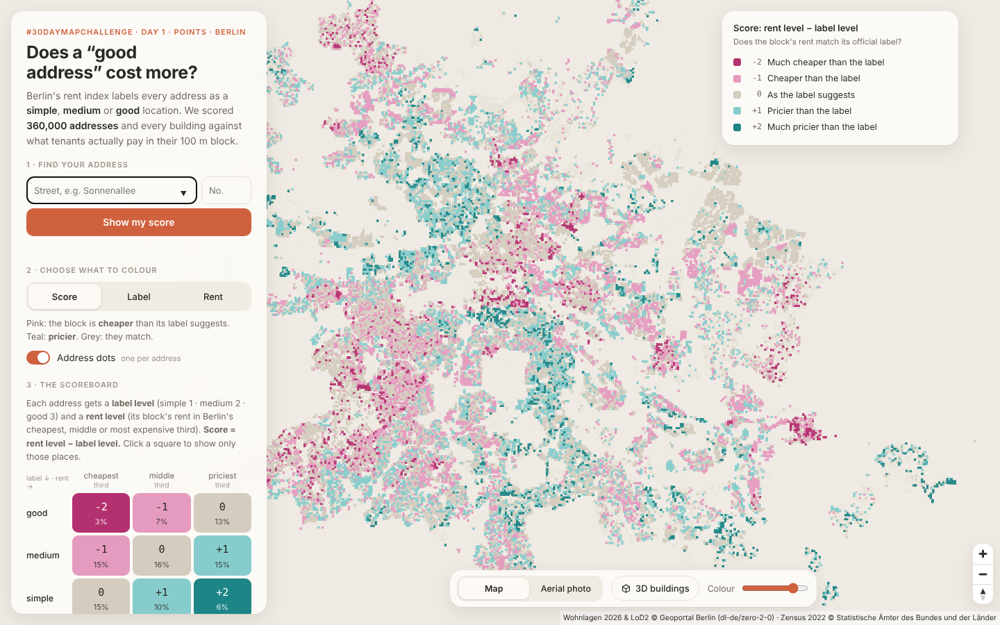

# Label vs. Reality – Berlin

**Does a "good address" in Berlin actually cost more?**



#30DayMapChallenge 2026 · **Day 1 · Points**

Berlin's rent index (*Mietspiegel*) sorts every residential address into a **simple**, **medium** or **good** location (*einfache / mittlere / gute Wohnlage*). This project sets **400,505 labelled addresses** from the Mietspiegel 2026 location map against the **average net rent** that tenants pay in each 100 m block (Zensus 2022).

The interactive map (`docs/`, served via GitHub Pages) shows:

* **Score** – does the rent of a block match its official label? (see *Scoring* below);
* **Label** – every address as a dot, coloured by its official location label;
* **Rent** – average net rent (€/m²) of existing tenancies per 100 m block;
* **3D buildings** – every LoD2 building of Berlin at its measured height, coloured by score, label or rent;
* **Aerial photo** – Berlin TrueDOP20 summer 2025 as base map;
* **Find your address** – label, block rent, rent level and score for any address;
* the interactive **scoreboard** (3 × 3 table), district and planning-area rankings, and **CSV downloads**.

## Scoring

| | cheapest third of rents (R = 1) | middle third (R = 2) | most expensive third (R = 3) |
|---|:---:|:---:|:---:|
| **good** label (L = 3) | **−2** | −1 | 0 |
| **medium** label (L = 2) | −1 | 0 | +1 |
| **simple** label (L = 1) | 0 | +1 | **+2** |

**Score = R − L.** R is the Berlin-wide third of the Zensus 2022 rent of the 100 m cell (thresholds 7.09 and 8.36 €/m²), L the Mietspiegel 2026 label level.
Negative = the block is cheaper than its label suggests, positive = pricier, 0 = as labelled.

Score tables in `docs/data/` (also downloadable on the map):

| File | One row per | Columns |
|---|---|---|
| `scores_addresses.csv.zip` | address | key, street, no., postcode, district, planning area, label, label level, **Gitter-ID**, rent €/m², value in brackets, rent level, score, score text |
| `scores_buildings.csv.zip` | LoD2 building (built by the Action) | building id, height, position, addresses per label, majority label, **Gitter-ID**, rent, rent level, score |
| `scores_planungsraum.csv` | planning area (LOR) | addresses, mean rent, label shares, mean score, share cheaper / as labelled / pricier |

## Key findings

| Label | Addresses | Mean rent | Median | Middle half (P25–P75) |
|---|---:|---:|---:|---:|
| simple (einfach) | 117,620 | 7.34 €/m² | 7.13 | 6.33 – 7.99 |
| medium (mittel) | 200,341 | 7.94 €/m² | 7.70 | 6.78 – 8.76 |
| good (gut) | 82,544 | 8.83 €/m² | 8.51 | 7.58 – 9.61 |

* "Good" addresses pay on average **about 20 % more** than "simple" ones (+1.49 €/m²).
* The ranges overlap strongly: a quarter of "good" addresses pay less than 7.58 €/m², a quarter of "simple" ones more than 7.99 €/m².
* Of addresses with a published rent, **26 %** live in blocks cheaper than their label suggests, **43 %** as labelled and **31 %** pricier.
* **1,080 blocks** are dominated by "good" labels but sit in Berlin's cheapest third of rents (score −2); **1,534 blocks** are mostly "simple" but sit in the most expensive third (score +2).

## Method

| Step | Script | What happens |
|---|---|---|
| 0 | `pipeline/fetch_inputs.py` | Downloads all inputs from the official services (WFS, Zensus zip, LoD2 ATOM feed). |
| 1 | `pipeline/build_data.py` | Reads all Wohnlagen 2026 addresses (EPSG:25833), removes duplicates, assigns each to its Zensus 100 m cell (EPSG:3035, `floor(x/100)·100 + 50`) and joins the cell's *Durchschnittliche Nettokaltmiete*. Values flagged `KLAMMERN` are kept but marked as less reliable. Rent bands = Berlin-wide thirds of address-level rent. Each address and block is scored (see *Scoring*); score tables are written as CSV. |
| 2 | `pipeline/lod2_to_footprints.py` | Reads every LoD2 tile (CityGML or CityJSON, also zipped) and keeps the ground surface and measured height of every building and building part. |
| 3 | `pipeline/build_buildings.py` | Gives each building the majority label of the addresses inside it (or within 10 m), the Gitter-ID and rent of the 100 m cell at its centre and its score; writes vector tiles `docs/data/buildings.pmtiles` (tippecanoe) and `scores_buildings.csv.zip`. |

Everything runs automatically in GitHub Actions (`.github/workflows/build-and-deploy.yml`).
Locally: `pip install -r requirements.txt`, install `tippecanoe`, then

```bash
python pipeline/fetch_inputs.py all
python pipeline/build_data.py --input input --out docs/data
python pipeline/lod2_to_footprints.py --lod2 input/lod2 --out input/berlin_lod2.parquet
python pipeline/build_buildings.py --input input --buildings input/berlin_lod2.parquet --height-field h --out docs/data
```

### Inputs

| Data | Source | Licence |
|---|---|---|
| Wohnlagen nach Adressen zum Berliner Mietspiegel 2026 (WFS `wohnlagenadr2026`) | Senatsverwaltung für Stadtentwicklung, Bauen und Wohnen Berlin | dl-de/zero-2-0 |
| Zensus 2022 – Durchschnittliche Nettokaltmiete, 100 m grid | Statistische Ämter des Bundes und der Länder | open data, attribution |
| 3D-Gebäudemodelle im Level of Detail 2 (LoD 2), Berlin (ATOM `a_lod2`) | Geoportal Berlin | dl-de/zero-2-0 |
| Basemap | © CARTO, © OpenStreetMap contributors | – |

### Limitations

* Zensus rent describes **existing tenancies on 15 May 2022**, not current asking rents; the location labels are from 2026.
* Rent is suppressed in cells with few rented flats: **33 %** of addresses fall in a cell without a published value.
* The location label describes the wider residential surroundings, not a single building or flat.
* This is a **spatial comparison of area-level data**. It makes no statement about individual flats, landlords or households.
* All 400,505 addresses of the WFS are used; 1,028,063 LoD2 buildings are drawn, 325,174 of them carry a label (an address inside or within 10 m).
* Building heights are LoD2 measured heights (generalised roof shapes); buildings are drawn as flat-roofed blocks.

## Structure

```
.github/workflows/   build-and-deploy.yml – fetch data, build, publish to GitHub Pages
docs/                the website (index.html, app.js, style.css, data/)
pipeline/            fetch_inputs.py, build_data.py, lod2_to_footprints.py, build_buildings.py
```

## Publish (one-time)

1. Create a new **public** repository and upload all files of this folder.
   Then add the workflow: on GitHub click **Add file → Create new file**, name it
   `.github/workflows/build-and-deploy.yml`, paste the content of `setup/build-and-deploy.yml` and commit.
2. **Settings → Pages → Build and deployment → Source: GitHub Actions.**
3. **Actions** tab → *Build data and deploy map* → **Run workflow** (it also runs on every push).
   The first run downloads Berlin's LoD2 models and takes about 30–60 minutes; later runs use the cache.
4. The map is published at `https://<user>.github.io/<repository>/`.

If a download fails, the workflow still publishes the map with the committed data (without 3D buildings).

---

Barış Parlatangiller · built with AI assistance (Claude, Anthropic). Code: MIT. Data: see licences above.
